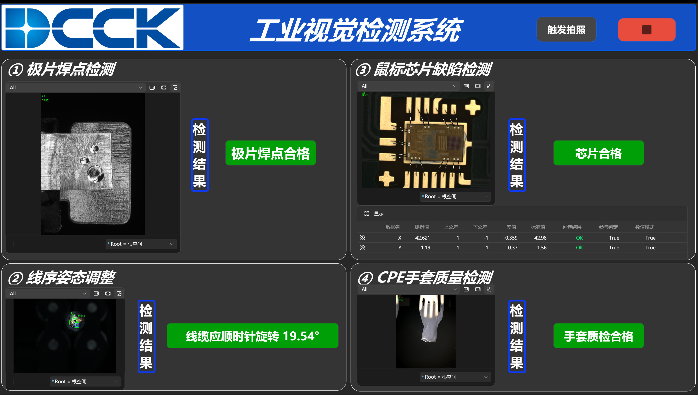
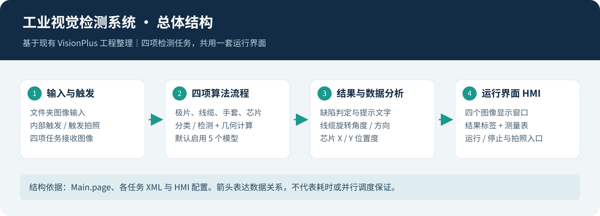

# 工业视觉检测系统 · 预选赛项目

基于 **VisionPlus / VisionTrainPlus** 的四任务工业视觉项目，包含极片焊点检测、线缆姿态调整、CPE 手套质检，以及鼠标芯片缺陷与位置度检测。

这是已完成工程的公开整理版：保留平台工程、原始算法配置、HMI、标定文件、训练项目与标注、导出模型及完整样本的配套资源。平台本身需要另行安装并取得有效许可。



*作者提供的最终运行截图，原图 3196 × 1812，未修改画面。该次画面显示极片、芯片与手套合格，线缆需顺时针旋转 19.54°。它展示一次运行状态，不代表完整测试集的准确率。*

**验证状态：已完成静态整理、图片来源核对、完整资源恢复与线缆计算脚本检查；整理后的工程尚未在商业平台内重新运行验收。**

[下载 v1.0.0 完整资源](https://github.com/anl2992019662-max/industrial-vision-prelim/releases/tag/v1.0.0) · [浏览图片与流程图](docs/gallery.md)

## 系统结构

[查看工程节点与数据流说明](docs/architecture.md)。



| 赛题任务 | 主要处理 | 输出 |
|---|---|---|
| 01 极片焊点 | 默认分类分支；保留停用的历史检测分支 | 合格或缺陷提示 |
| 02 线缆姿态 | 线芯检测 → 中心坐标 → C# 旋转计算 | 角度、旋转方向、复检提示 |
| 03 CPE 手套 | 默认分类分支 | 空模、破损或合格提示 |
| 04 鼠标芯片 | 标定、模板定位、几何测量、检测与分类 | 缺陷结论、X/Y 位置度与公差判定 |

原 HMI 将芯片放在右上方并标为 ③，手套放在右下方并标为 ④；上表采用赛题顺序。截图与工程保留原布局。

## 先看这些资料

- [完整图片与各任务流程](docs/gallery.md)：实际运行截图、22 张赛题插图、5 张结构/流程图、原工程流程缩略图。
- [安装与运行](docs/reproduction.md)：资源包校验、独立运行副本生成、路径绑定、平台运行步骤。
- [赛题要求对应表](docs/requirements.md)：哪些已有配置或截图证据，哪些还需要复测。
- [模型、数据与训练工程](docs/resources.md)：完整资源恢复方式、默认依赖、数据来源及历史分支。
- [已完成检查与已知限制](docs/validation.md)：区分脚本测试、文件检查和平台运行验收。
- [授权范围与第三方说明](THIRD_PARTY_NOTICES.md)：MIT 只覆盖有权授权的原创部分。

## 快速开始

环境参考：Windows、VisionPlus 4.2.3、VisionTrainPlus 1.0.0（本机原工程环境），Python 3.10 或更高。其他平台版本的工程兼容性未验证。运行本工程不需要安装 Python 的第三方包。

1. 从 [v1.0.0 Release](https://github.com/anl2992019662-max/industrial-vision-prelim/releases/tag/v1.0.0) 下载 `industrial-vision-prelim-source.zip` 并解压；把所需配套 ZIP 放在主项目文件夹旁边的 `release-assets` 文件夹。默认推理仅需 `model-library.zip`；恢复完整数据还需全部 18 个 `dataset-pool-XX.zip`。
2. 安装并授权 VisionPlus。不要把软件安装目录或许可文件复制到仓库。
3. 在主项目目录运行：

```powershell
python tools/prepare.py --assets ../release-assets --destination runtime
```

4. 在 VisionPlus 中打开生成的 `runtime/project/program1.5.vpsx`，检查四个输入目录、模型路径和标定文件，再进入运行模式。
5. 点击运行与“触发拍照”，按[复现与验收清单](docs/reproduction.md)核对画面和结果。

默认附有每项 3 张全幅演示图。恢复完整数据和训练图片布局时使用：

```powershell
python tools/prepare.py --assets ../release-assets --destination runtime-full --with-dataset
```

脚本先核对资源 SHA-256，再创建新目录。不会覆盖已有运行副本。完整数据默认使用同盘硬链接减少重复占用；需要独立可修改的副本时增加 `--copy-data`。

> 只想检查界面和配置时可用 `--demo-only`。该模式不带模型，不能完成推理，不能作为运行成功的证据。

## 项目内容

```text
project/                 平台工程、算法配置、HMI、标定、演示输入与训练元数据
src/cable_rotation.cs    从平台工程原样提取的线缆计算脚本（仅统一换行）
tools/prepare.py         校验资源、恢复文件并绑定本机路径
tools/verify.py          文件完整性、依赖和文档引用检查
tests/                  原始 C# 脚本的独立数学与异常测试
docs/                   图解、运行说明、赛题对应和验收记录
manifests/              模型、图片、资源包和来源的 SHA-256 清单
LICENSE                 原创部分的 MIT 许可证
THIRD_PARTY_NOTICES.md   平台、赛题素材和标识的权利边界
```

主项目不存放大型 `.bin` 模型与完整图像库；它们在配套资源 ZIP 中，按清单恢复到相同逻辑路径。训练日志、优化器断点、账户数据库、保护配置、缓存与历史备份不纳入发布。

## 验证范围

线缆原始脚本通过 10 项数学与错误输入检查，包括 ±19.54°、±90°、180°、缺少颜色与候选分数选择。测试不调用视觉推理。

默认启用流程引用的 5 个模型均已找到。另有 12 处停用分支引用，其中 1 处历史文件缺失，已在清单中标明。不得直接启用该分支后宣称依赖完整。

本次整理没有重新训练、修改检测阈值、重新标定或测量整集精度。训练工程中的历史指标保留在元数据内，未作为独立验证结果展示。详见[验证记录](docs/validation.md)。

## 许可

作者有权授权的原创工程配置、自编脚本、训练配置/标注及自有模型采用 [MIT](LICENSE)。第三方平台、赛题 PDF、赛题样本、商标与标识不自动适用 MIT，详见[第三方说明](THIRD_PARTY_NOTICES.md)。
