# 图片与流程图

## 最终运行界面

作者提供的历史运行原图。与下面的赛题要求插图分开标明：赛题插图不是本工程推理结果。

## 总体结构

## 原平台流程缩略图

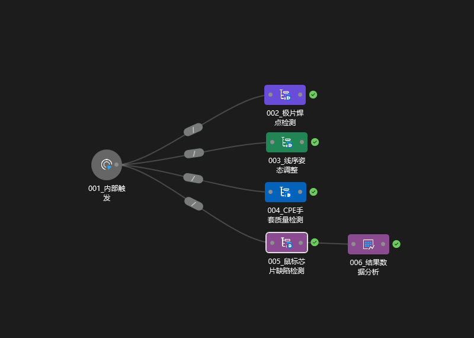

原工程自带缩略图，保留原分辨率，不用插值重画冒充更高清的原图。

## 极片焊点检测

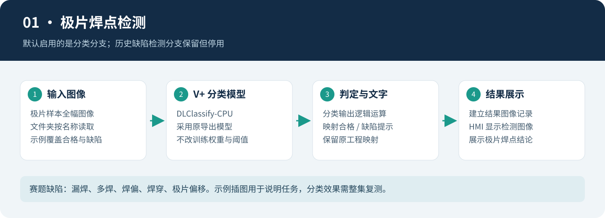

| 极片：漏焊 | 极片：多焊 | 极片：焊偏 |
| --- | --- | --- |
| 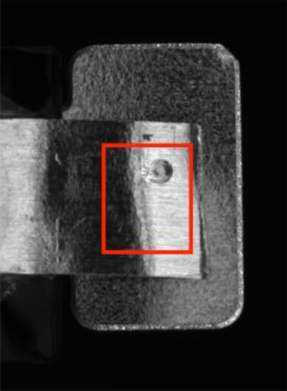 | 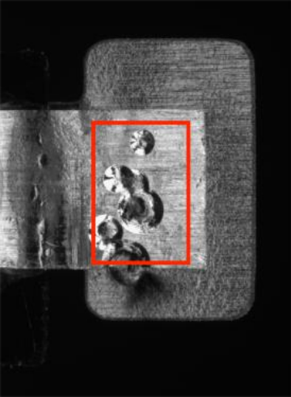 | 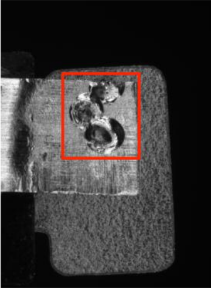 |

| 极片：焊穿 | 极片：偏移 | 极片：合格 |
| --- | --- | --- |
| 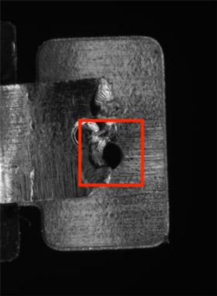 | 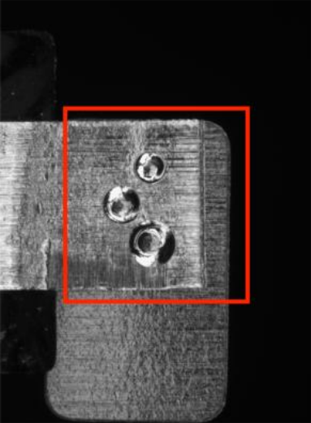 | 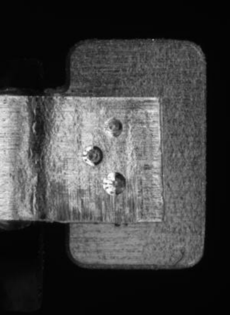 |

来源：赛题 PDF 第 4 页；裁切只提取说明图，保留原图中的缺陷标记。

## 线缆姿态调整

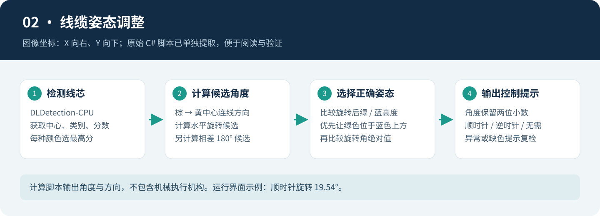

| 线缆：标准姿态 | 线缆：待旋转 | 线缆：角度示意 |
| --- | --- | --- |
| 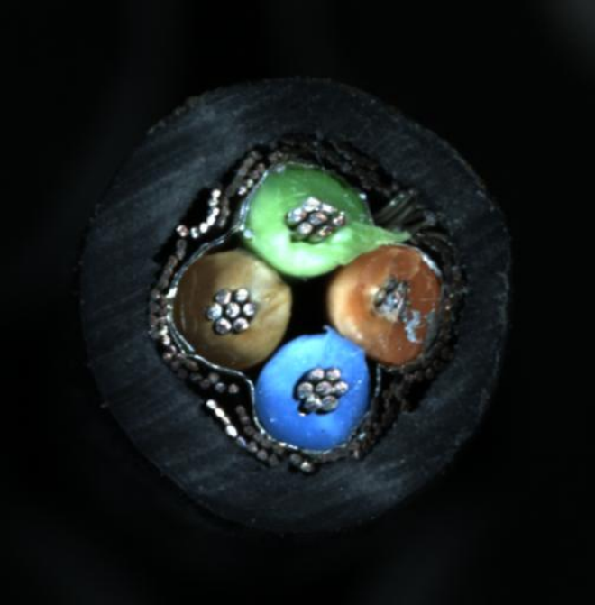 | 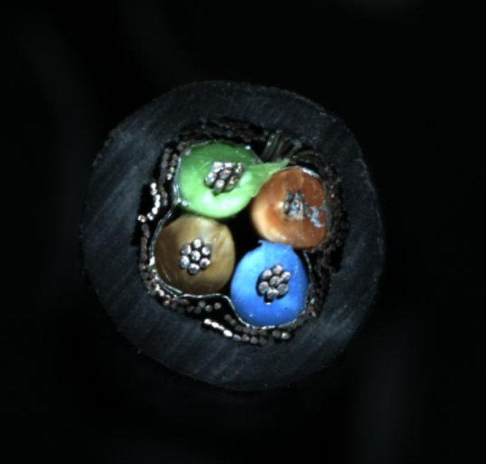 | 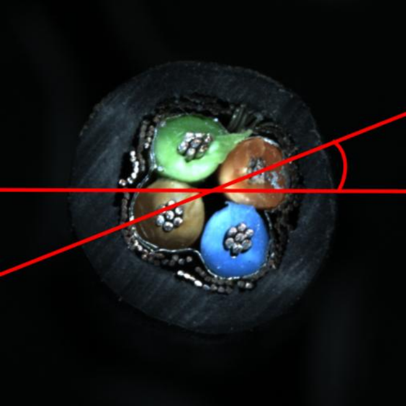 |

来源：赛题 PDF 第 5 页；裁切只提取说明图，保留原图中的缺陷标记。

## CPE 手套质检

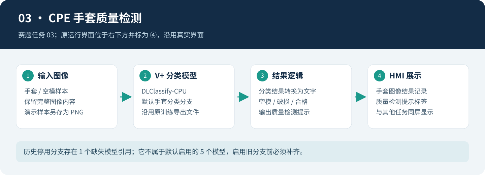

| 手套：空模 | 手套：破损 | 手套：合格 |
| --- | --- | --- |
| 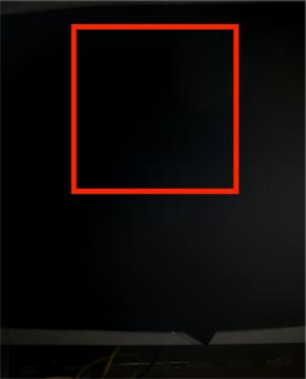 | 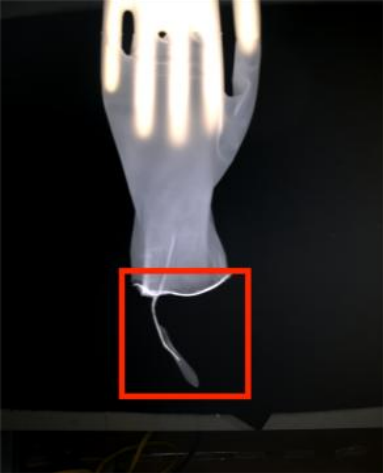 | 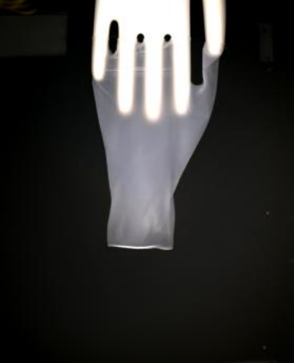 |

来源：赛题 PDF 第 5 页；裁切只提取说明图，保留原图中的缺陷标记。

## 芯片缺陷与位置度

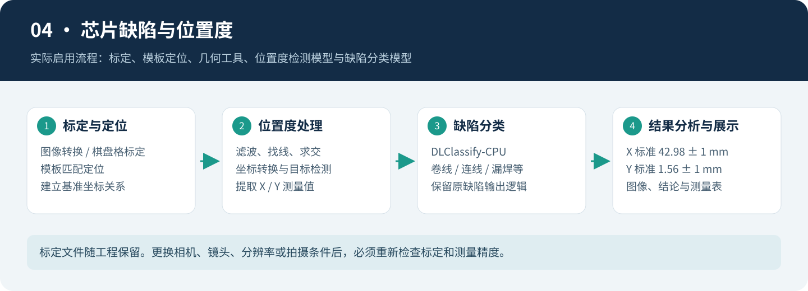

| 芯片：卷线 | 芯片：连线 | 芯片：漏焊 |
| --- | --- | --- |
| 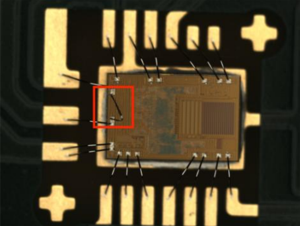 | 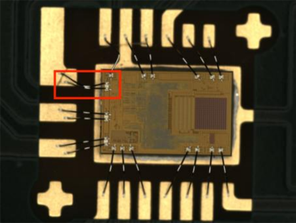 | 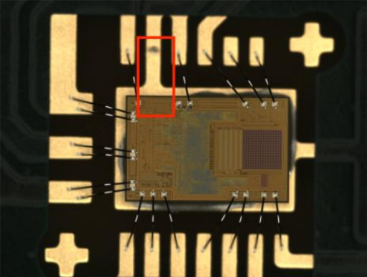 |

| 芯片：偏线 | 芯片：弯线 | 芯片：合格 |
| --- | --- | --- |
| 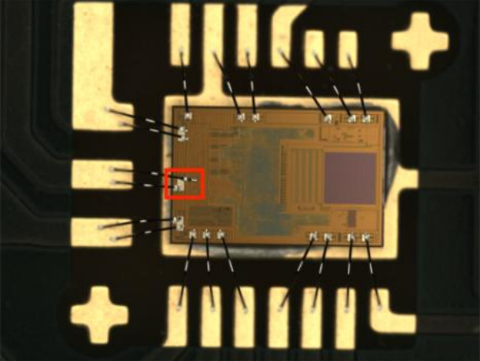 | 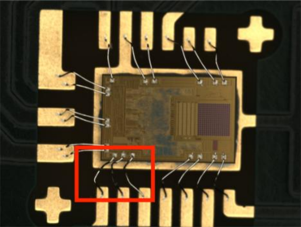 | 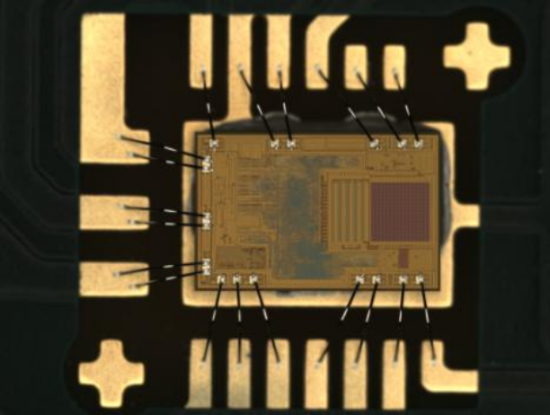 |

| 芯片位置：X 基准 | 芯片位置：Y 基准 | 芯片位置：基准总览 |
| --- | --- | --- |
| 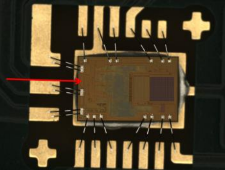 | 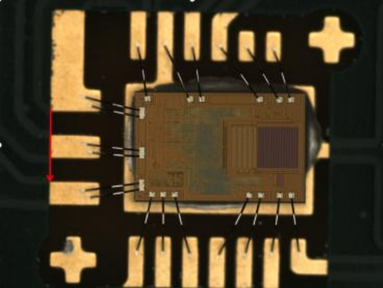 | 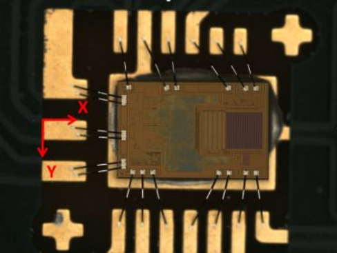 |

| 芯片位置：位置度 |
| --- |
| 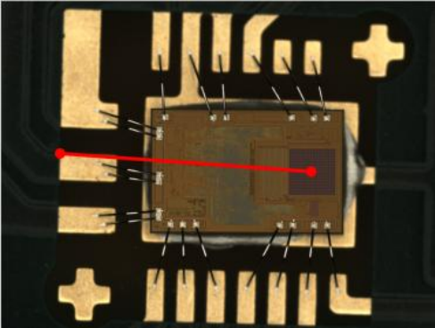 |

来源：赛题 PDF 第 6 页；裁切只提取说明图，保留原图中的缺陷标记。

## 来源与区分

22 张赛题插图由本地 PDF 渲染裁切，原页码、区域和哈希记录于 `manifests/figures.json`。5 张 SVG 是依据工程重新绘制的结构/流程说明；实际运行截图未作编辑。详见[第三方说明](../THIRD_PARTY_NOTICES.md)。
